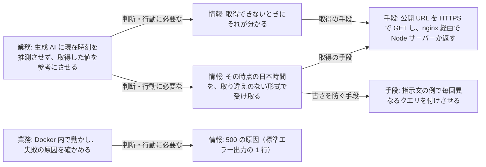

## 要求一覧

[機能要求一覧](004_機能要求一覧.md)と[非機能要求一覧](005_非機能要求一覧.md)に、個別の要求を記す。共通の用語とデータ項目は[用語集](012_用語集.md)を参照する。

### 対象範囲

| 対象となる業務・機能・成果物 | 扱い | 理由・関連する要求 | 根拠・確認先 |
|---|---|---|---|
| nginx から HTTP で要求を受け、現在時刻を返す Node サーバー | 対象 | 今回の作業範囲。REQ-1、REQ-2、REQ-3、REQ-11 | 依頼原文「時刻サーバーを実現したい」、D-4、D-7 |
| GET であればどのパスにも時刻を返すこと、HEAD を GET と同じに扱うこと | 対象 | REQ-1 | D-13、D-20 |
| 待ち受けアドレス（既定 127.0.0.1）とポート（既定 3000）の設定による変更 | 対象 | REQ-12、REQ-13 | D-8、D-16、D-21、D-26 |
| 500 を返したときの原因の標準エラー出力（1 行） | 対象 | REQ-14 | D-23 |
| Node サーバーを動かす Dockerfile | 対象 | 利用者は Node サーバーを Docker 内で動かす。REQ-15 | D-22、D-25 |
| 生成 AI への指示文の例 | 対象 | 依頼の目的「参照するように指示したい」と、D-9 により付け忘れの対策が指示だけになるため。REQ-5 | 依頼原文、D-9、D-17 |
| compose の設定 | 対象外 | D-25 の説明文で含めないと明示された | D-25 |
| VPS、nginx、TLS（HTTPS から HTTP への変換）の設定と nginx の設定例 | 対象外 | 利用者が行う。nginx の設定は D-25 の説明文でも含めないと明示された | D-7、D-25 |
| 公開側の対策（質問 D の文面で挙げた認証とレート制限を含む、公開に伴う対策のすべて） | 対象外 | 利用者が行う。Node サーバーには持たせない | D-7 |
| コンテナの常駐・自動起動の仕組み（例: 再起動の方針、OS 起動時の起動） | 対象外 | D-25 は Dockerfile だけを加えたもので、常駐・自動起動は含まれないことからの AI の判断（人のレビューで確認）。起動するコマンドは対象（REQ-9） | D-7 の補足、D-25 |
| ホスト側のポートの公開（`-p 127.0.0.1:3000:3000`）の操作 | 対象外 | 利用者が Docker の実行時に行う操作（AI の解釈）。説明を成果物に書くかは申し送り | D-26、要件定義への申し送り |
| Claude Code の WebFetch（HTTPS の公開 URL）で読める応答 | 対象 | 生成 AI の呼び出し方法。REQ-4 | D-3、D-4、D-11、C-8 |
| WebFetch 以外の生成 AI ツールからの呼び出し | 対象外 | WebFetch だけと回答された | D-11 |
| 同じマシンの平文 HTTP を Web 取得ツールで直接読む呼び出し | 対象外 | 動作確認で取得できず、質問 A への回答で公開サーバー経由に変わった | C-8、D-4 |
| シェルで curl を実行する呼び出し | 対象外 | 質問 A の選択肢にあったが選ばれず、HTTPS の公開サーバーへ GET する方式が示された | D-4 |
| MCP サーバーとしての提供 | 対象外 | 依頼原文の意向（「MCPにするほどでもない」）と、質問 A への回答による | 依頼原文、D-4 |
| クエリ文字列の有無と値に関係ない応答 | 対象 | Web 取得ツールの保持を毎回異なる URL で避けるため。クエリなしでも時刻を返す。REQ-11 | D-6、D-9 |
| クエリの付け忘れを Node サーバーで検出・拒否すること | 対象外 | 付け忘れによる古さは指示で防ぐ | D-9 |
| 日本時間以外のタイムゾーンでの返却 | 対象外 | JST 固定が選ばれた | D-2 |
| 時刻の正確さの保証（NTP との照合、同期状態の判定） | 対象外 | OS の時計のずれは許容する | C-3 |

対象範囲に対応する業務の流れは、[ユースケース](011_ユースケース.md)の図とシナリオで示す。

### 経営・業務・情報ニーズ

| 区分 | ニーズと期待する効果 | 関連する目的・要求 | 根拠・確認先 |
|---|---|---|---|
| 経営 | 該当なし。個人の開発補助ツールで、経営上の成果は関係しない（AI の解釈） | - | 依頼原文に経営上の目的の記載なし |
| 業務 | 生成 AI に作業させるとき、現在時刻を推測させず、取得した値を参考にさせたい。MCP より簡単な手段で済ませたい | 背景・目的、REQ-4、REQ-5 | 依頼原文「httpで取得して参照するように指示したい」「MCPにするほどでもない」 |
| 業務 | 運用者が、Node サーバーを Docker 内で動かし、時刻を返せなかった原因を確かめられること | REQ-14、REQ-15 | D-22、D-23、D-25 |
| 情報 | 生成 AI がその時点の日本時間を、取り違えのない形式で受け取れること | REQ-1、REQ-2、REQ-7、REQ-10、REQ-11 | 依頼原文、D-2、D-5、D-6、D-9、D-15、C-4 |
| 情報 | 時刻を取得できないとき、それが分かること（誤った時刻を受け取らないこと） | REQ-3 | C-4、C-7、D-12 |

#### ニーズの関連図

経営ニーズは該当しないため、業務ニーズと情報ニーズの関係を描く。

手段の成立条件のうち、Web 取得ツールの保持による古い値は D-6（毎回 URL を変える）で避け、付け忘れは指示文の例で防ぐ（D-9、D-17）。D-6 は保持がクエリ文字列を区別することを前提にしており、未確認である（C-8 の補足）。nginx から Node サーバーへの経路は、コンテナ内の待ち受けアドレス（D-8、D-26）とポート（D-16、D-21）、ホスト側の公開（利用者、D-26）、nginx の転送先の設定（利用者、D-7）を合わせて成り立つ。

### 管理指標の定義（指標 BOOK）

| 指標 | 対象・算出方法 | 単位・測定期間 | データ・ソース | 除外条件 | 根拠・確認先 |
|---|---|---|---|---|---|
| なし | 数値の管理指標を設けない（[背景・目的](001_背景・目的.md)の成功要因と管理指標を参照） | - | - | - | 依頼原文に指標の記載なし。AI の解釈で、人のレビューで確認する |

### アプリケーション・タイプとツール選定指針

| アプリケーション・タイプ | 判断理由 | ツール要求 | 選定時に確認すること | 根拠・決定状態 |
|---|---|---|---|---|
| HTTP API（Docker コンテナ内で、リバースプロキシの nginx の後ろで動き、短い文字列を返す） | 呼び出し元は画面を持たない生成 AI で、HTTPS で GET して本文を取得すると回答にある。HTTPS は nginx が終端する。処理は現在時刻の取得と整形だけで、保存するデータはない | TypeScript / Node.js（24 以上）で実装し、ConoHa の Debian 上の Docker コンテナで動かす。Dockerfile を用意する。平文 HTTP で待ち受ける。待ち受けアドレスとポートは設定で変えられる。TLS、認証、レート制限は持たない | Dockerfile の基盤が Node.js 24 以上か、待ち受けアドレス（D-8、D-26）とポート（D-21）がホスト側の公開と nginx の転送先に合うか | 依頼原文、C-1、C-10、C-11、D-4、D-7、D-22、D-25、D-26、C-9。タイプは回答に基づく AI の判断 |
| MCP サーバー | 質問 A への回答で HTTP の方式が示されたため採らない | - | - | D-4 |
| 画面、定期処理、分析・可視化 | 利用者との接点は生成 AI からの HTTP 要求だけで、該当しない | - | - | AI の判断 |

ツール選定の指針: 実行環境は C-1、C-10、C-11 による。HTTP の実装手段は `.claude/rules/coding.md` の 1 章（`node:http` を基本、ランタイム依存は根拠を書いて足す）に従う。これは AI 作成ルールで、要件定義で適用する。
