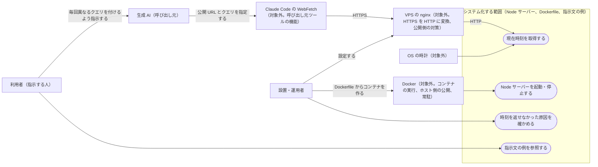

## ユースケース

[要求一覧](003_要求一覧.md)の対象範囲と、[利用者と利用場面](002_利用者と利用場面.md)の利用者・関係者に対応付ける。

### 業務視点の情報系ユースケース図

### ユースケースのシナリオ

| 対応するユースケース | シナリオ | 利用者・開始条件 | 業務の流れと扱う情報 | 期待する結果・対応 | 根拠・確認先 |
|---|---|---|---|---|---|
| 指示文の例を参照する | 通常 | 利用者。生成 AI に時刻の取得を指示したい | 成果物の指示文の例（公開 URL の形、毎回異なる `?t=<任意の値>`、日本時間であること、取得できないときは推測しないこと）を読み、生成 AI への指示に使う | 生成 AI が指示どおりに呼び出す | REQ-5、D-17 |
| 現在時刻を取得する | 通常 | 生成 AI。Node サーバーと nginx が動いている | 生成 AI が WebFetch で `https://<公開ホスト>/<任意のパス>?t=<任意の値>` を GET し、nginx が HTTP で Node サーバーへ渡し、Node サーバーがその時点の OS の時計の値を日本時間にして返す | 生成 AI が `YYYY-MM-DD HH:mm:ss`（19 文字、末尾改行なし）を受け取り、参考の現在時刻として使う | REQ-1、REQ-2、REQ-4、REQ-11、D-2、D-4、D-5、D-6、D-13、D-15 |
| 現在時刻を取得する | 代替: HEAD | 呼び出し元。HEAD で要求する | GET と同じに扱う | 本文なしの 200 を受け取る | REQ-1、D-20 |
| 現在時刻を取得する | 続けて呼び出す | 生成 AI。時間をおいて再び時刻が必要になる | 前回と異なるクエリの値を付けて取得する | WebFetch の保持を通らず、その時点の時刻を受け取る（保持がクエリ文字列を区別することが前提。C-8 の補足） | REQ-7、REQ-11、C-8、D-6 |
| 現在時刻を取得する | 代替: クエリの付け忘れ・同じ値の再利用 | 生成 AI。クエリを付けない、または前回と同じ値を付ける | Node サーバーに届けばその時点の時刻を返す。WebFetch が保持していれば要求は届かず、保持された結果が渡る | 最大 15 分ほど古い時刻を受け取る可能性が残る。指示文の例で防ぐ（Node サーバーでは見分けられない） | C-8、D-9、D-17 |
| 現在時刻を取得する | 代替: 誤ったパス | 生成 AI。指示と異なるパスを GET する | Node サーバーはどのパスにも時刻を返す | 時刻を受け取る。URL の誤りには気付けない（残るリスク） | D-13 |
| 現在時刻を取得する | 例外: 時刻の取得・整形の失敗 | 生成 AI。Node サーバー内で時刻の取得または整形に例外が起きる、または値が返却形式に収まらない | Node サーバーは 500 と時刻の形式を含まない短いエラー文を返し、原因を標準エラー出力に 1 行出す | 生成 AI が取得できなかったと分かり、時刻を推測しない | REQ-3、REQ-14、C-7、D-12、D-17、D-23 |
| 現在時刻を取得する | 例外: Node サーバー停止中 | 生成 AI。Node サーバーまたはコンテナが動いていない | nginx がエラーを返す | 生成 AI が取得できなかったと扱う。運用者がコンテナを起動する | REQ-9、D-7、D-17 |
| 現在時刻を取得する | 例外: 第三者からの呼び出し | インターネット上の第三者 | 公開 URL の任意のパスを呼び出す | 対策は利用者が Node サーバーの外（nginx を含む）で行う | D-4、D-7、D-13 |
| 時刻を返せなかった原因を確かめる | 通常 | 設置・運用者。生成 AI が時刻を得られなかったと分かった | コンテナのログ（標準エラー出力）で、500 を返したときの 1 行を読む | 原因を確かめ、対処する | REQ-14、D-23 |
| Node サーバーを起動・停止する | 通常 | 設置・運用者。生成 AI を使う前 | ConoHa の Debian で、Dockerfile からコンテナを作る。待ち受けアドレスに 0.0.0.0 を指定してコンテナを起動し、ホスト側は 127.0.0.1 のポート 3000 に公開する。停止はコンテナを止めて行う | Node サーバーが nginx からの HTTP 要求を待つ。常駐の仕組みは利用者が用意する | REQ-6、REQ-9、REQ-12、REQ-13、REQ-15、D-7、D-21、D-22、D-25、D-26 |
| Node サーバーを起動・停止する | 代替: コンテナの外で動かす | 設置・運用者または開発者。開発機（Windows 11）で動かす | コマンドで Node サーバーを前面で起動する。待ち受けアドレスは既定の 127.0.0.1、ポートは既定の 3000 | Node サーバーが 127.0.0.1:3000 で待ち受ける | REQ-9、REQ-12、REQ-13、D-8、D-21 |
| Node サーバーを起動・停止する | 例外: ポートの使用中 | 設置・運用者。待ち受けるポートを他のプログラムが使っている | 起動に失敗する | 運用者が失敗に気付き、ポートを設定で変えるか他のプログラムを止める | REQ-13、D-16、要件定義への申し送り |
