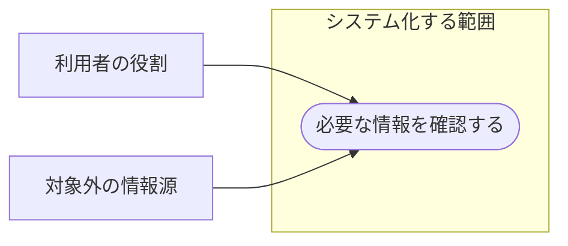

## ユースケース

[要求一覧](003_要求一覧.md)の対象範囲と、[利用者と利用場面](002_利用者と利用場面.md)の利用者・関係者に対応付ける。

### 業務視点の情報系ユースケース図

<!-- 利用者が情報を取得・確認・共有し、何を判断または実行するかを業務の言葉で描く。対象範囲、利用者、他システムとの境界が図から分かるようにし、図とシナリオでユースケース名をそろえる。記入例のノードは実際の役割と業務に置き換える。 -->

### ユースケースのシナリオ

<!-- 同じ業務目的でも、前提や結果が変わる複数パターンを添える。通常の流れに加え、別の利用条件、情報が得られない場合、例外時などから実際に該当するものを記す。 -->

| 対応するユースケース | シナリオ | 利用者・開始条件 | 業務の流れと扱う情報 | 期待する結果・対応 | 根拠・確認先 |
|---|---|---|---|---|---|
| <図のユースケース名> | 通常 | <利用者と正常に利用できる条件> | <情報の取得から判断・行動まで> | <業務上の結果> | <資料の箇所・REQ-n・Q-n> |
| <図のユースケース名> | 代替・例外 | <別の前提、情報不足、異常が起こる条件> | <通常と変わる箇所、利用者や運用者の対応> | <続行、代替、停止の扱い> | <資料の箇所・REQ-n・Q-n> |
