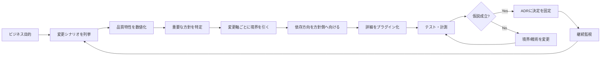

## エグゼクティブサマリ

このプレイブックは、**「アーキテクチャについて知っている」状態から、「日々の設計・実装・レビューで使える」状態へ落とし込むための実践リファレンス**である。中心テーマは、ソフトウェアアーキテクチャを「技術スタックや箱の配置」ではなく、**変更コストを抑え、重要な方針を詳細から守り、将来の選択肢を残すための依存関係と境界の設計**として捉えることである。

最も重要な結論は、**良いアーキテクチャとは「正しい構成図」ではなく、重要な変更を安く、安全に行える構造である**、という点にある。アーキテクチャの目的は、システムの構築・保守に必要な人的労力を最小限に保つことであり、ソフトウェアの価値は「現在要求された振る舞い」と「将来変更できる構造」の二つに分けられる。したがって、短期機能だけを優先して構造を劣化させることは、将来の機能開発速度そのものを失う行為になる。

また、アーキテクチャは一回決めて完成する成果物ではない。アーキテクチャは、**実装と計測によって検証する仮説**として扱う。SEIも、品質特性間のシナジーやトレードオフを継続的に評価し、アーキテクチャ分析を一度きりの活動ではなく継続的なガバナンスとして行うことを推奨している。

実務上は、次の流れにすると再現性が高い。

実践時にまず問うべきなのは、「マイクロサービスにするか」「どのDBを使うか」「どのフレームワークを使うか」ではない。**誰が何を変更するのか、どの変更を他の変更から守る必要があるのか、その変更を何時間・何日以内で安全に行いたいのか**である。UI、Web、DB、フレームワーク、サービス形態などは本質的な方針より外側の「詳細」とみなし、重要なビジネスルールをそれらから独立させる。特にWebは提供方式、DBは永続化機構、フレームワークは道具として扱い、アプリケーションのユースケースをそれらに従属させない。

### このプレイブックの前提と未指定事項

このプレイブックの対象は**業務アプリケーション／Web・APIシステム／バックエンドサービスを中心とするソフトウェアアーキテクチャ**とする。組込み・リアルタイム系にも原則の多くは適用できるが、ハードリアルタイム制約、機能安全、航空・医療等の規制認証については未指定である。利用言語、クラウド、オンプレミス、組織規模、SLA、データ量、規制要件、予算、チーム数も未指定である。

したがって実践時には、仮に次を置いて開始することを推奨する。中規模以上の長寿命システム、複数人チーム、要件変更が継続する業務アプリケーション、RDBまたは外部サービスとの連携あり、CI/CDあり、という条件である。この仮定から外れる場合は、境界や抽象化を減らしてよい。**Clean Architectureを完全実装すること自体は目的ではない。変更コストに見合うだけの境界を設けることが目的である。**「部分的な境界」という選択肢もあり、境界にはコストがあるため全面的な分離が常に正解ではない。

### 要求成果物と想定粒度

以下は、このプレイブックを社内標準や設計ガイドへ展開した場合の想定ページ数である。A4相当を想定しており、ページ数は実装例や組織固有ルールを加えると増減する。

| 成果物 | 想定ページ | 粒度 | 主な用途 |
|---|---:|---|---|
| エグゼクティブサマリ | 2–3 | 概要 | 経営・PM・リード向け |
| アーキテクチャ原則集 | 12–18 | 詳細手順 | 設計・実装時 |
| 境界・依存関係設計ガイド | 8–12 | 詳細手順 | 新規設計・リファクタリング |
| 品質特性・トレードオフ評価 | 6–10 | 詳細手順＋テンプレート | アーキレビュー |
| アンチパターン集 | 8–12 | 兆候＋改善手順 | 技術負債診断 |
| 設計レビューチェックリスト | 3–5 | テンプレート | PR・設計レビュー |
| 意思決定フロー | 2–4 | 概要＋図 | 設計時 |
| ADRテンプレート | 2–3 | テンプレート | 意思決定記録 |
| C4構成図セット | 4–8 | テンプレート | コミュニケーション |
| 導入優先順位 | 2–3 | 概要 | 改善計画 |
| 実行ロードマップ | 4–6 | 詳細手順 | 3–6か月改善 |
| 合計目安 | **53–84** | ― | 実践用ハンドブック |

ISO/IEC/IEEE 42010は、アーキテクチャそのものと「アーキテクチャを記述した成果物」を区別し、ステークホルダーの関心事をそれぞれ適切なviewpoint/viewで表現する考え方を採用している。したがって、一枚の「万能アーキテクチャ図」を作るより、目的別に図を分ける方が望ましい。
