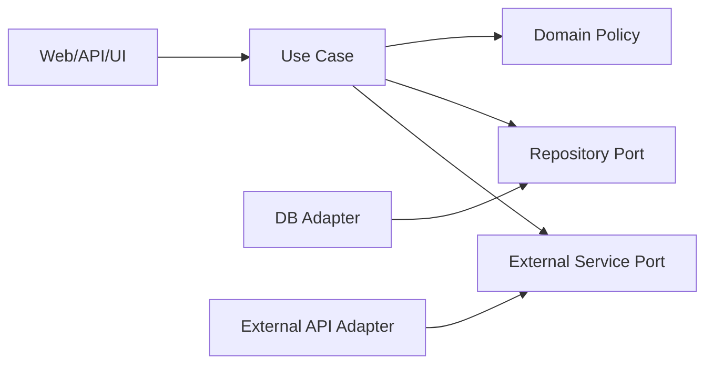
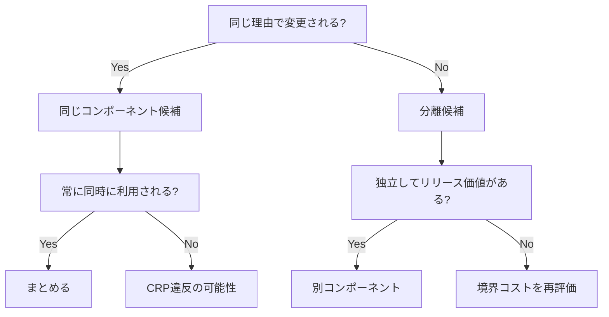

## アーキテクチャを設計するための中核原則

### 変更コストを最上位の評価軸に置く

アーキテクチャ上重要な決定は「変更コスト」で評価する。良い設計とは、システムのライフタイムを通して変更に要する労力を低く維持するものである。また、要件変更の困難さは変更の「大きさ」に比例すべきであり、現在のコード構造への「当てはまり方」に左右されるべきではない。

**背景。** 現場で「アーキテクチャの良し悪し」が主観論になりやすい最大の理由は、評価軸を決めていないことである。「きれい」「モダン」「マイクロサービス」「DDDっぽい」は評価基準にならない。

**目的。** 頻繁に起きる重要な変更を、局所的・予測可能・テスト可能にする。

**原則。**

> アーキテクチャの価値は、重要な変更をどれだけ小さな影響範囲で、安全に実施できるかで評価する。

**実行手順。**

1. 過去6〜12か月の変更チケットを30〜50件集める。
2. 「誰の要求か」「何が変わったか」「何ファイル／何コンポーネントに波及したか」「リードタイム」「障害有無」を記録する。
3. 今後2年間に予想される変更を10〜20個列挙する。
4. 頻度×ビジネス影響×変更コストで順位付けする。
5. 上位5変更について、影響が一つの境界内に収まる構造を優先して設計する。
6. 実際の変更PRから変更面積を継続計測する。

**良い例。** 決済プロバイダをStripeから別サービスへ変更したとき、決済アダプターと設定だけを変更し、注文ユースケースには変更が入らない。

**悪い例。** DBカラム名変更により、Controller、DTO、ドメインモデル、テンプレート、バッチ、SQL、外部APIレスポンスまで同名で変更される。

**判断基準。** 「典型的変更一件が一つの境界内に閉じるか」「重要な方針より詳細側で変更を吸収できるか」を見る。

**トレードオフ。** 境界を増やせば変更独立性は上がるが、インターフェイス、DTO、マッピング、テスト、認知負荷も増える。

**例外。** 数週間で廃棄するPoCや、一度生成して二度と変更しないコードでは、抽象化コストの方が大きい場合がある。

**検証方法。** 四半期ごとに「変更1件当たり変更コンポーネント数」「変更1件当たりレビュー時間」「変更起因の障害率」を追う。

### 「方針」と「詳細」を分け、依存方向を制御する

DIPおよびClean Architectureの中心は、**上位レベルの方針が下位レベルの変化しやすい具象詳細に依存しない**構造である。UIやDBはビジネスルールのプラグインとし、依存関係を制御の流れと逆方向に向けられることが、ポリモーフィズムのアーキテクチャ上の価値である。



上図で重要なのは物理配置ではなく、**ソースコード依存が中心の方針へ向くこと**である。

**実行手順。**

1. 「このシステムが存在する理由」を動詞で列挙する。例：注文を確定する、与信する、配送を割り当てる。
2. 技術固有語を除く。SQL、Kafka、REST、React、AWSなどを一旦消す。
3. 各ユースケースが必要とする外部機能をPortとして定義する。
4. DB、API、メッセージングはAdapterとしてPortを実装する。
5. Composition Root/Mainだけが具象を組み立てる。
6. アプリケーション層からORM・HTTP SDK・クラウドSDKへのimportを禁止する。
7. 静的解析またはArchUnit等で依存方向をCI検証する。

たとえばTypeScriptなら、概念的には次の程度で十分である。

```ts
export interface PaymentGateway {
  authorize(orderId: string, amount: Money): Promise<AuthResult>;
}

export class ConfirmOrder {
  constructor(
    private readonly payment: PaymentGateway,
    private readonly orders: OrderRepository,
  ) {}

  async execute(cmd: ConfirmOrderCommand): Promise<void> {
    const order = await this.orders.get(cmd.orderId);
    order.confirm(await this.payment.authorize(order.id, order.total()));
    await this.orders.save(order);
  }
}
```

ここで`ConfirmOrder`がStripe SDK、SQL、HTTPステータスコードを知らないことが重要である。

**悪い例。**

```ts
class OrderService {
  async confirm(id: string) {
    const row = await prisma.order.findUnique(...);
    const stripe = new Stripe(process.env.STRIPE_KEY!);
    await stripe.paymentIntents.create(...);
    return new Response(JSON.stringify(row), { status: 200 });
  }
}
```

このコードでは、ユースケース、永続化、決済、HTTP、設定が同じ変更単位に融合している。

**判断基準。** 「DBを消してもユースケーステストが動くか」「HTTPサーバーなしでユースケースを呼べるか」「外部API SDKを交換してもビジネスロジックが無変更か」。フレームワーク、Webサーバー、DBを起動せずにユースケースをテストできることは、重要な特性である。

### 境界は「名詞」ではなく「変更の軸」で引く

SRPは「一つのことをする」原則ではなく、**一つのアクターに責務を負う**原則である。給与計算、人事帳票、DB保存を同じEmployeeクラスに置く例では、異なるステークホルダーによる変更が同一モジュールで衝突することが問題とされる。コンポーネントレベルではCCPとして、同時に変更されるものを同じコンポーネントへまとめる。

したがって、`controller/service/repository`という技術レイヤーだけでパッケージングすると、同一ユースケースの変更が複数ディレクトリへ散乱しやすい。

**悪い構成。**

```text
controllers/
  order.ts
  customer.ts
services/
  order.ts
  customer.ts
repositories/
  order.ts
  customer.ts
models/
  order.ts
  customer.ts
```

**改善候補。**

```text
orders/
  confirm/
    ConfirmOrder.ts
    ConfirmOrderCommand.ts
    PaymentGateway.ts
  shipping/
    AllocateShipment.ts
  domain/
    Order.ts
  adapters/
    SqlOrderRepository.ts
    StripePaymentGateway.ts
```

これは「ユースケースを叫ぶアーキテクチャ」に近い。トップレベルの構造を見た人が、このシステムが何をするものか理解できることが重要である。フレームワーク中心の構造よりもユースケース中心の構造を重視する。

### SOLIDをクラス設計ではなく変更制御として使う

SOLIDは、中間レベルのソフトウェア構造を「変更に強く、理解しやすく、コンポーネントの基盤として利用可能」にするための原則である。

| 原則 | 実務での問い | ダメな兆候 | 修正方法 |
|---|---|---|---|
| SRP | 誰がこのコードを変更させるか | 異なる部門要求が同じモジュールで衝突 | アクター別に分離 |
| OCP | 新しい種類を「追加」で対応できるか | `if provider == ...` が増殖 | Strategy/Plugin化 |
| LSP | 実装を交換しても呼出側が特別扱い不要か | 実装別条件分岐 | 契約統一または別抽象 |
| ISP | 利用者は不要なAPIへ依存していないか | 巨大インターフェイス | Consumer別Port |
| DIP | 方針が技術詳細を知っていないか | DomainがSDK/DBをimport | Portを方針側に置く |

LSP違反は特に見落とされやすい。例えば、交換可能であるはずのREST実装に一社だけ異なるフィールド名が存在すると、呼び出し側に会社名を判定する特殊処理が発生し、アーキテクチャが例外処理だらけになる。これは現在のSaaS統合でも非常に起こりやすい。

### コンポーネントは「一緒に変更・リリース・再利用するもの」でまとめる

REP・CCP・CRPは、コンポーネントの粒度を考える際の非常に実践的な三角形になる。REPは再利用単位とリリース単位の一致、CCPは同じ理由で変更されるものの集約、CRPは一緒に利用されないものを不用意にまとめないことを求める。

実務上は次のように判断する。



**注意点。** 「再利用できそうだから共通ライブラリにする」は弱い理由である。共通ライブラリ化すると、利用者がそのライブラリの変更・バージョニング・互換性管理に依存する。二つの類似コードが今後別々に変化するなら、重複を残す方が結合を減らせることもある。

### 非循環依存を守る

コンポーネント依存に循環が生じると、独立ビルド、独立テスト、独立リリース、影響範囲分析が難しくなる。コンポーネント結合の原則であるADP（Acyclic Dependencies Principle）に従い、依存の循環をなくす。

**検出方法。**

```text
order → customer → pricing → order
```

があれば警告する。

**改善順序。**

1. 共通している真の抽象を切り出す。
2. 依存方向を逆転できないか検討する。
3. イベントで時間的結合を切る必要があるか検討する。
4. そもそも二つを分割すべきでなかった可能性を検討する。

最後が重要である。循環があるからイベント化、は危険である。境界そのものが誤っている可能性がある。
