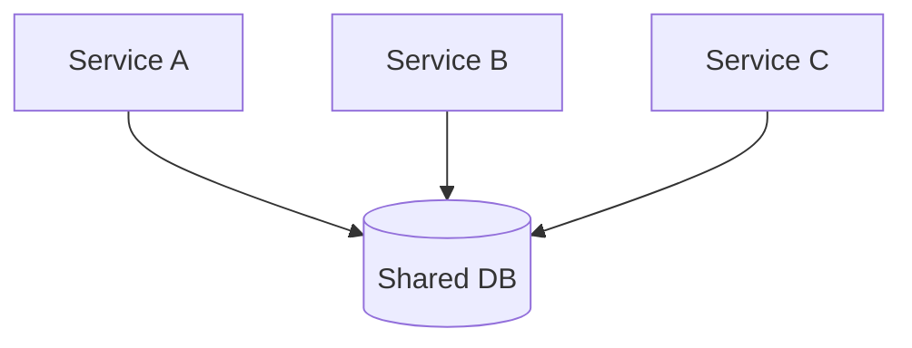

## アンチパターンと改善プレイブック

### 「あとで直す」アーキテクチャ

まず市場投入を優先し「後でクリーンにする」と考えても、次の機能要求が続くため実際には修復の機会が来ず、構造劣化によって生産性が低下する。これが典型的な罠である。また全面リライトも、同じ設計習慣のままでは同じ崩壊を繰り返す。

**兆候。**

- 変更のたびに影響調査が長くなる。
- 小さな機能なのに複数チーム調整が必要。
- 「そこを触ると何が壊れるかわからない」が頻出。
- リリースごとに開発速度が落ちる。
- テストに数時間かかるため実行されない。

**改善手順。**

1. 全面リライトを禁止する。
2. 変更頻度の高いユースケースを一つ選ぶ。
3. Characterization Testを置く。
4. 新旧コードの間に境界を作る。
5. 新規変更は新境界側だけで行う。
6. 旧コードをストラングラー方式で縮小する。
7. リードタイムが改善したか測る。

### フレームワーク主導設計

**兆候。**

```text
src/
  controllers/
  entities/
  repositories/
  services/
```

しか見ても何のシステムかわからない。

**問題。** ビジネス構造よりフレームワーク構造が上位概念になっている。フレームワークは便利な詳細として利用するものであり、アプリケーションをフレームワークへ強く結婚させるとリスクになる。

**改善。**

```text
src/
  orders/
  payments/
  fulfillment/
  customer-support/
```

を第一階層にする。技術層は各機能内部またはadapter配下へ移す。

### 巨大Serviceクラス

```text
OrderService
  create
  cancel
  refund
  ship
  invoice
  mail
  audit
  retry
  exportCsv
```

**兆候。** 500〜3000行のService、数十依存、巨大Mockセット。

**原因。** 「Orderという名詞」に集約し、変更理由を分けていない。

**改善。**

```text
CreateOrder
CancelOrder
RefundOrder
AllocateShipment
GenerateInvoice
```

へユースケース単位に分割する。共有するビジネスルールだけDomainへ移す。

### 巨大インターフェイス

```java
interface UserRepository {
  User get();
  void save();
  void delete();
  Report export();
  void purge();
  List<User> search();
  ...
}
```

**問題。** 利用者が不要な変更にも依存するISP違反になる。不要な依存は、再コンパイル・再デプロイだけでなく、上位アーキテクチャでの障害伝播も引き起こしうる。

**改善。**

```text
UserReader
UserWriter
UserSearch
```

のように「利用者が必要とする契約」で分割する。ただし1メソッドinterfaceを機械的に大量生成する必要はない。変更軸が同じならまとめてよい。

### 共有DBによる疑似マイクロサービス



**兆候。**

- 他サービスのテーブルを直接JOIN。
- DB migrationで全サービス調整。
- 所有者不明のテーブル。
- 同時デプロイ。

**改善。**

1. テーブルごとの所有サービスを決める。
2. 他サービスからの書込みを停止。
3. 読取りAPIまたはイベントを設ける。
4. クロス境界トランザクションを洗い出す。
5. 必要ならSaga/outbox等を導入。
6. 最後に物理DBを分離する。

**重要。** 最初からDBを物理分離してはいけない。論理所有権を先に確立する。

### 条件分岐によるプラグイン擬態

```ts
if (provider === "A") ...
else if (provider === "B") ...
else if (provider === "C") ...
```

**兆候。** 新規プロバイダ追加のたびに中心ロジックを変更する。

**改善。**

```ts
interface ShippingRateProvider {
  quote(req: QuoteRequest): Promise<Quote>;
}
```

各実装を外側へ配置する。これはOCP、LSP、DIPをまとめて適用する典型例である。

### イベント駆動万能論

イベントは疎結合化に有用だが、同期APIより常に優れているわけではない。

**危険信号。**

- イベント名から業務意味がわからない。
- Consumer数を誰も把握していない。
- schema変更ルールがない。
- replayすると副作用が二重発生。
- 「イベントだから疎結合」とだけ説明する。

**改善。**

1. Producer/Consumerを列挙。
2. Delivery semanticsを決める。
3. 冪等キーを設計。
4. Schema互換ルールを定める。
5. Dead-letter処理を決める。
6. 再処理手順を実地テスト。
7. 「同期APIでは不十分な理由」をADRに書く。

### 抽象化のしすぎ

Clean Architectureを読んだ直後に起きやすい逆方向の失敗である。

```text
IOrderService
OrderServiceImpl
IOrderFactory
OrderFactoryImpl
IOrderRepository
OrderRepositoryImpl
...
```

**問題。** 変化しないものまで抽象化し、コード量と認知負荷を増やす。

DIPでも、すべての具象への依存を排除できるわけではなく、安定した標準クラスなどへの具象依存は許容する。

**抽象化する条件。**

```text
変化の可能性が高い
AND
変更影響を隔離する価値が高い
AND
境界の契約が意味を持つ
```

三つのうち二つ以上が満たされないなら、直接依存を許容する候補である。
