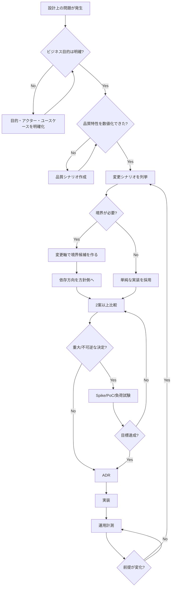
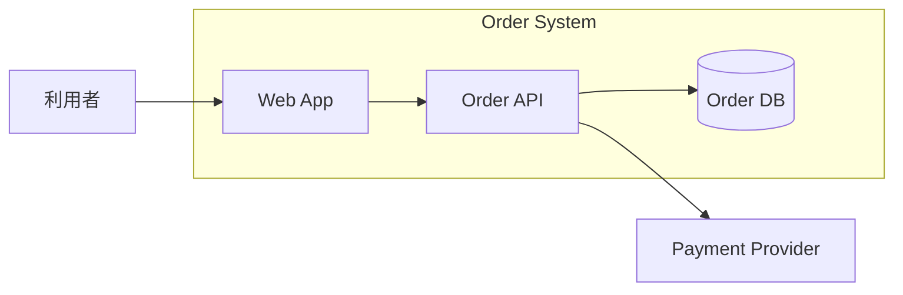
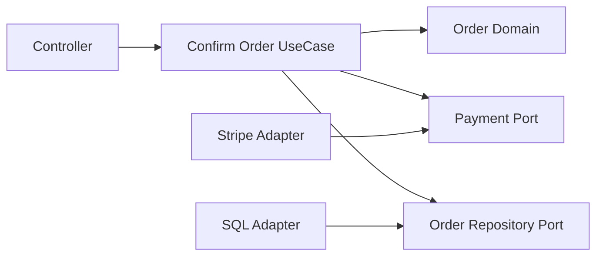

## 設計・レビューで直接使うテンプレート

### アーキテクチャ設計レビュー・チェックリスト

以下はコピーしてPRテンプレートや設計テンプレートに使用できる。

```markdown
# Architecture Review Checklist

## 目的
- [ ] この変更が解決するビジネス問題が一文で書かれている
- [ ] 主要ユースケースが特定されている
- [ ] ステークホルダー／アクターが特定されている

## 変更容易性
- [ ] 予想される変更シナリオを3件以上列挙した
- [ ] 頻繁に変わる部分と安定した部分を分けた
- [ ] 変更が不要なコンポーネントへ波及しない
- [ ] 循環依存がない

## 境界
- [ ] 境界が技術レイヤーだけでなく変更理由に対応している
- [ ] 境界を跨ぐ契約が明示されている
- [ ] 境界内部の詳細を外へ漏らしていない
- [ ] DB Entityを境界外APIとして直接公開していない

## 依存性
- [ ] ビジネス方針がDB/HTTP/UI/SDKへ直接依存していない
- [ ] 依存方向が重要な方針へ向いている
- [ ] 外部サービスはAdapterとして隔離されている
- [ ] Composition Rootが明確である

## 品質特性
- [ ] 可用性目標が数値化されている
- [ ] レイテンシ目標が数値化されている
- [ ] 想定負荷が数値化されている
- [ ] セキュリティ要件が明示されている
- [ ] コスト制約が明示されている

## 障害
- [ ] DB停止時の挙動を決めた
- [ ] 外部API timeout時の挙動を決めた
- [ ] Retry条件を決めた
- [ ] Retryによる二重実行を考慮した
- [ ] Partial failureを考慮した
- [ ] 復旧手順が存在する

## データ
- [ ] データ所有者が明確
- [ ] Transaction boundaryが明確
- [ ] Migration方法が定義されている
- [ ] 個人情報／秘密情報の扱いが定義されている

## セキュリティ
- [ ] Trust boundaryを確認した
- [ ] 認証位置が明確
- [ ] 認可位置が明確
- [ ] Threat Modelを更新した
- [ ] Audit log要否を確認した

## テスト
- [ ] Domain/Use Caseを外部依存なしでテストできる
- [ ] Adapter contract testがある
- [ ] Failure pathのテストがある
- [ ] Migration rollbackをテストした

## 運用
- [ ] SLIを定義した
- [ ] メトリクスを定義した
- [ ] 構造化ログを定義した
- [ ] Trace propagationを定義した
- [ ] Alert条件を定義した

## 意思決定
- [ ] 代替案が2案以上ある
- [ ] トレードオフを記録した
- [ ] ADRを作成した
- [ ] 再評価条件を定義した
```

このチェックリストは、ISO 42010の「ステークホルダーと関心事を明示する」考え方、SEIの品質特性評価、Google SREの運用計測、OWASP/NISTのセキュリティ原則を、境界・依存関係中心の思想へ統合したものである。

### 意思決定フロー



判断の中心は「元に戻すコスト」である。可逆な決定は短く決め、不可逆・高コストな決定に検証時間を集中する。

### ADRテンプレート

ADRは、一つの重要なアーキテクチャ判断とその理由を短い文書として残す手法である。一つの ADR には一つの重要な決定だけを書き、短く保つ。

```markdown
# ADR-XXXX: <意思決定タイトル>

Status: Proposed | Accepted | Deprecated | Superseded
Date: YYYY-MM-DD
Owners:
Review date:

## Context
どの問題を解決するのか。
現状、制約、ビジネス背景を記載する。

## Decision Drivers
- 変更容易性:
- 信頼性:
- 性能:
- セキュリティ:
- コスト:
- 開発速度:
- 運用容易性:

## Quality Attribute Scenarios
例:
- 2,000 req/sでp95 < 300ms
- 単一AZ障害から5分以内に回復
- Provider追加を1人日以内で実装

## Considered Options

### Option A
概要:

メリット:
-

デメリット:
-

### Option B
概要:

メリット:
-

デメリット:
-

## Decision
採用案:

## Rationale
なぜこの案を選んだか。

## Consequences

### Positive
-

### Negative
-

### Risks
-

## Validation
どの試験・メトリクスで判断が正しかったか検証するか。

## Rollback / Exit Strategy
前提が外れた場合どう戻すか。

## Revisit Triggers
以下の場合にADRを再検討する:
- 負荷がXを超えた
- チーム数がYを超えた
- コストがZを超えた
- SLAが変更された

## Related
- C4 diagram:
- Threat model:
- Benchmark:
- Related ADR:
```

ADRの重要な点は「正解を永久保存する」ことではなく、**その時点の前提・判断材料・犠牲にしたものを保存すること**である。

### C4による構成図

C4 Modelは、Software System、Container、Component、Codeという階層的抽象を用い、System Context、Container、Component、Codeの図を用途に応じて使い分ける。さらにDynamic、Deployment等の補助図も用意される。記法やツールには依存しない。

実務では全レベルを描く必要はない。通常は、

```text
System Context
      ↓
Container
      ↓
重要箇所だけ Component
```

で十分である。



ここで止めず、重要な内部依存をComponent図で説明する。



図には必ず次を付ける。

```text
タイトル
目的
スコープ
凡例
主要責務
依存方向
同期/非同期
重要なプロトコル
更新日
ADRリンク
```

箱だけ描いた「PowerPointアーキテクチャ」にしないことが重要である。ISO 42010も、単一図ではなく関心事に対応したview/viewpointによる記述を求める。
