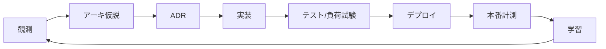

## 導入優先順位と実行ロードマップ

### 優先順位

全システムを一度にClean Architecture化する必要はない。最も効果が高い順に進める。

| 優先度 | 施策 | 理由 | 難易度 |
|---|---|---|---|
| S | 主要変更シナリオを明文化 | 以後の判断軸になる | 低 |
| S | 依存関係・循環を可視化 | 現状把握 | 低 |
| S | 重要ユースケースのテスト確保 | 安全な変更基盤 | 中 |
| S | ADR導入 | 判断の蒸発を防ぐ | 低 |
| A | 外部API/DB境界の明確化 | 変更隔離効果が大きい | 中 |
| A | ユースケース単位への再編 | 責務明確化 | 中 |
| A | 品質特性を数値化 | 設計判断の客観化 | 中 |
| A | 観測性整備 | アーキ仮説の検証 | 中 |
| B | CIで依存ルールを検証 | 劣化防止 | 中 |
| B | C4図整備 | 共通理解 | 低 |
| B | Threat Modeling | セキュリティ設計 | 中 |
| C | サービス分割 | 必要性が証明されてから | 高 |
| C | Event Sourcing等の高度パターン | 条件限定 | 高 |

### 最初の二週間

**目的は設計変更ではなく、現状を可視化すること。**

実施する。

```text
1. 主要ユースケース10個を列挙
2. 過去の変更30件を分析
3. 変更頻度上位5箇所を特定
4. コンポーネント依存グラフを生成
5. 循環依存を抽出
6. 外部依存一覧を作成
7. 重要な品質要件を5件数値化
8. System Context / Container図を作成
```

成果物は「現状アーキテクチャ・ベースライン」とする。

### 最初の一か月

**対象ユースケースを一つだけ選ぶ。**

選定条件は、

```text
変更頻度が高い
×
障害影響が大きい
×
境界が曖昧
```

である。

対象に対して、

```text
Controller
↓
Use Case
↓
Domain
↓
Ports
↑
Adapters
```

へ整理する。

ここでClean Architecture全社標準化を宣言しない。**一つの縦切りスライスで効果を測る。**

測定する。

```text
変更ファイル数
テスト時間
レビュー時間
Lead Time
障害率
開発者の理解時間
```

### 二〜三か月

PoCで改善が確認できたら、境界ルールをCIへ移す。

例：

```text
domain -> framework 禁止
application -> infrastructure 禁止
feature A -> feature B の内部実装禁止
循環依存禁止
```

加えて、

```text
ADRテンプレート
C4テンプレート
品質シナリオテンプレート
設計レビューチェックリスト
Threat Modeling
```

を標準化する。

この段階では「アーキテクトの承認」を増やしすぎない。目的は統制ではなく、**判断品質をチーム全体へ分散すること**である。

### 三〜六か月

ここから物理境界を検討する。

次の条件が実測で確認された箇所だけサービス分割候補とする。

```text
独立した変更頻度が高い
AND
独立デプロイ価値が高い
AND
データ所有権を分割可能
AND
チーム所有権が明確
AND
分散運用コストを負担できる
```

条件を満たさない場合はモジュラーモノリスを維持する。

### 継続運用

SEIはアーキテクチャ分析を一回限りのレビューではなく、品質特性間のトレードオフを継続的に分析する活動として扱っている。したがって、半年に一度大規模レビューを行うより、設計変更時・重大インシデント後・大規模負荷変化時に再評価する方が効果的である。

推奨トリガーは次の通りである。

```text
重要障害発生
主要SLO未達
新規外部サービス導入
データ所有権変更
チーム分割
新規規制対応
負荷2倍以上
主要フレームワーク更新
サービス分割
重大ADRの前提崩壊
```

最終的には以下のサイクルを組織習慣にする。


